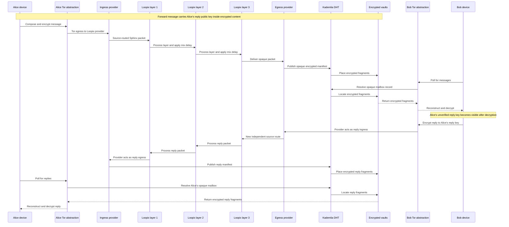

# Trustless Mixnet DHT Messaging Simulator

A distributed, trustless and anonymity-focused messaging network simulator using mixnet routing, DHT discovery and decentralised encrypted storage.

## The problem

Conventional messaging and email systems depend on identifiable accounts, trusted service operators and infrastructure that can reveal sender, recipient and location metadata. Encrypting message content alone does not conceal who communicated, where they connected from or how a message travelled.

This project explores simple text messaging from Alice, or any number of senders, to Bob or other recipients, with anonymous replies and without relying on username-and-password accounts. Participants instead use disposable combinations of cryptographic keys and message vaults. The intended design layers independent source, destination and routing protections so privacy does not depend on any single component.

The objective is a private, trustless delivery model in which network nodes may be unavailable, compromised or malicious, while a recipient can verify that retrieved ciphertext was not altered and decrypt it without intermediary nodes reading it. Even modified node software should encounter encrypted material rather than readable message text. Sender authentication remains a separate unresolved protocol concern.

This is a thought experiment implemented as a local simulation of the relevant hardware roles, network nodes and protocol behaviour. It does not prove complete anonymity, untraceability or production security.

## What the simulator models

The simulator makes an end-to-end message journey visible and inspectable:

- multiple people sending text messages and anonymous replies;
- a separate Tor abstraction for every participant;
- the Loopix 2017 stratified mixnet algorithm, including independent source routes, Sphinx packet processing, exponential per-hop delays and Poisson cover traffic;
- the original 2002 Kademlia DHT algorithm, including 160-bit IDs, XOR distance, `k = 20` buckets, `alpha = 3` parallel lookups and the defined RPC behaviour;
- encrypted message chunking, replicated distributed storage, retrieval and reconstruction;
- independently changing node availability;
- recipient polling rather than unsolicited delivery;
- deterministic scenarios reproduced from a random seed;
- typed network-step objects and the events produced as each step executes;
- an inert global observer reserved for a future, explicitly defined observer or adversary model.

Python is authoritative for all simulation state and decisions. The browser only controls and visualises the simulation. The first implementation uses simulated local components and does not connect to Tor, public DHT peers, mixnet operators or distributed storage services.

Technology labels are fidelity claims. A node shown as Kademlia or Loopix must execute that named algorithm rather than a generic approximation. The UI displays the protocol name, paper/version, active parameters and any explicitly documented simulator boundary. The combined messaging architecture is experimental; using faithful subsystem algorithms does not make the whole system a formally verified implementation.

Reference algorithms:

- [The Loopix Anonymity System, USENIX Security 2017](https://www.usenix.org/system/files/conference/usenixsecurity17/sec17-piotrowska.pdf)
- [Kademlia: A Peer-to-peer Information System Based on the XOR Metric, 2002](https://pdos.csail.mit.edu/~petar/papers/maymounkov-kademlia-lncs.pdf)

## End-to-end message flow



Every arrow represents a Python-owned `NetworkPath` with its own logical transit delay. Loopix mixing delay occurs inside each mix layer and playback delay only controls presentation speed.

## Code components

- **Python simulation engine (`python/`):** people, cryptographic identities, Tor abstractions, Loopix providers and mix nodes, Kademlia DHT nodes, storage nodes, network steps, scheduling, availability and message processing.
- **FastAPI service:** typed HTTP commands, health and state endpoints, plus a WebSocket event stream.
- **SvelteKit/Vite web client (`web/`):** connection and configuration screens, controls, algorithm inspectors and event timeline.
- **D3/SVG visualisation:** topology, actual routes, alternatives, failures, retries and node state.
- **Cryptography layer:** maintained Python primitives for recipient confidentiality, ciphertext integrity, key agreement and reply-key handling.

The implementation specification is in [`.agents/instructions/distributed-messaging-simulator-implementation.md`](.agents/instructions/distributed-messaging-simulator-implementation.md). The repository currently contains the specification and project documentation; application scaffolding and dependencies will be added during implementation.

## Prerequisites

The planned implementation requires:

- Python 3.12 or a compatible version declared by `python/pyproject.toml`;
- Node.js 20 LTS or a compatible version declared by `web/package.json`;
- npm;
- two local terminal sessions;
- a modern browser with WebSocket and SVG support.

Exact Python and JavaScript dependencies will be installed from the committed lock and project files once those files exist. Expected core dependencies include FastAPI and Uvicorn for the Python service, and SvelteKit, Vite and D3 for the web client.

## Installation

After the implementation files have been added:

```bash
python -m venv .venv
source .venv/bin/activate
python -m pip install -e "./python[dev]"

cd web
npm install
```

Use the final commands and version constraints recorded in the project files if they differ from this provisional setup.

## Running the simulator

Start the Python backend from the repository root:

```bash
source .venv/bin/activate
python python/main.py
```

The backend binds to `127.0.0.1`, selects an available port beginning at `8000`, and prints its actual HTTP and WebSocket endpoints.

In a second terminal, start the frontend:

```bash
cd web
npm run dev
```

Open the local URL printed by Vite, enter the backend port or URL, test the connection, configure and create the simulation, then press **Run**. Connecting does not create or start a simulation automatically.

## Documentation

User-facing guides belong in `docs/`. Agent implementation specifications and instructions belong in `.agents/instructions/`.
