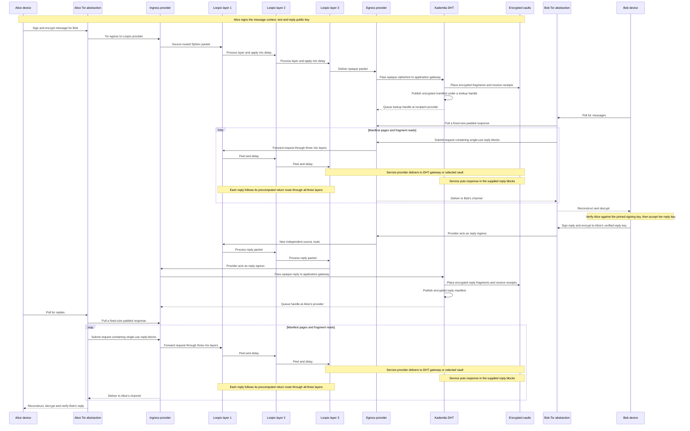

# Trustless Mixnet DHT Messaging Simulator

A distributed, trustless and anonymity-focused messaging network simulator using mixnet routing, DHT discovery and decentralised encrypted storage.

## The problem

Conventional messaging and email systems depend on identifiable accounts, trusted service operators and infrastructure that can reveal sender, recipient and location metadata. Encrypting message content alone does not conceal who communicated, where they connected from or how a message travelled.

This project explores simple text messaging from Alice, or any number of senders, to Bob or other recipients, with anonymous replies and without relying on username-and-password accounts. Participants instead use disposable combinations of cryptographic keys and message vaults. The intended design layers independent source, destination and routing protections so privacy does not depend on any single component.

The objective is a private, trustless delivery model in which network nodes may be unavailable, compromised or malicious, while a recipient can verify that retrieved ciphertext was not altered and decrypt it without intermediary nodes reading it. Even modified node software should encounter encrypted material rather than readable message text. Each device signs its messages and replies with Ed25519. The recipient checks the signature against the signing key pinned to the expected participant ID for this simulation. Real-world identity verification is outside the model.

This is a thought experiment implemented as a local simulation of the relevant hardware roles, network nodes and protocol behaviour. It does not prove complete anonymity, untraceability or production security.

## What the simulator models

The simulator makes an end-to-end message journey visible and inspectable:

- multiple people sending text messages and anonymous replies;
- an independently configured connection channel for each participant (Tor, Outline Shadowsocks or direct);
- the Loopix 2017 stratified mixnet algorithm, including independent source routes, Sphinx packet processing, exponential per-hop delays and Poisson cover traffic;
- the original 2002 Kademlia DHT algorithm, including 160-bit IDs, XOR distance, `k = 20` buckets, `alpha = 3` parallel lookups and the defined RPC behaviour;
- encrypted message chunking, replicated distributed storage, retrieval and reconstruction;
- independently changing node availability;
- recipient polling rather than unsolicited delivery;
- deterministic scenarios reproduced from a random seed;
- typed network-step objects and the events produced as each step executes;
- an inert global observer reserved for a future, explicitly defined observer or adversary model.

Python is authoritative for all simulation state and decisions. The browser only controls and visualises the simulation. The first implementation uses simulated local components and does not connect to Tor, public DHT peers, mixnet operators or distributed storage services.

Technology labels are fidelity claims. A node shown as Kademlia or Loopix must execute that named algorithm rather than a generic approximation. The UI displays the protocol name, paper/version, active parameters and any explicitly documented simulator boundary. The combined messaging architecture is experimental; using faithful subsystem algorithms does not make the whole system a formally verified implementation.

Reference algorithms:

- [The Loopix Anonymity System, USENIX Security 2017](https://www.usenix.org/system/files/conference/usenixsecurity17/sec17-piotrowska.pdf)
- [Kademlia: A Peer-to-peer Information System Based on the XOR Metric, 2002](https://pdos.csail.mit.edu/~petar/papers/maymounkov-kademlia-lncs.pdf)

## End-to-end message flow



Transfers between network nodes traverse a Python-owned `NetworkPath` with its own logical transit delay. Device cryptography and local storage operations run on their owning nodes. Loopix mixing delay occurs inside each mix layer and playback delay only controls presentation speed.

## Code components

- **Python simulation engine (`python/`):** people, cryptographic identities, connection channels, Loopix providers and mix nodes, Kademlia DHT nodes, storage nodes, network steps, scheduling, availability and message processing.
- **FastAPI service:** typed HTTP commands, health and state endpoints, plus a WebSocket event stream.
- **SvelteKit/Vite web client (`web/`):** connection and configuration screens, controls, algorithm inspectors and event timeline.
- **D3/SVG visualisation:** topology, actual routes, alternatives, failures, retries and node state.
- **Cryptography layer:** maintained Python primitives for recipient confidentiality, ciphertext integrity, key agreement and verification of device signatures against per-run pins.

The implementation specification is in [`.agents/instructions/distributed-messaging-simulator-implementation.md`](.agents/instructions/distributed-messaging-simulator-implementation.md).

## Prerequisites

Local development requires:

- Python 3.11 or newer;
- Node.js 22.17+ (22.x) or 24+;
- npm;
- two local terminal sessions;
- a modern browser with WebSocket and SVG support.

The Python package declares the service dependencies. The web client uses the committed npm lockfile.

## Installation

From the repository root:

```bash
python -m venv .venv
source .venv/bin/activate
python -m pip install -e "./python[dev]"

cd web
npm ci
```

## Running the simulator

Start the Python backend from the repository root:

```bash
source .venv/bin/activate
python python/main.py
```

The backend binds to `127.0.0.1`, selects an available port beginning at `8000`, and prints its actual HTTP and WebSocket endpoints.

In a second terminal, start the frontend:

```bash
cd web
npm run dev
```

Open the local URL printed by Vite, enter the backend port or URL, test the connection, configure and create the simulation, then press **Run**. Connecting does not create or start a simulation automatically.

## Documentation

- [Conversation setup and runtime interventions](docs/conversations.md)
- [Local HTTP and WebSocket contract](docs/local-api.md)
- [Loopix routing and provider discovery](docs/protocols/loopix.md)
- [Kademlia, bootstrap recovery and replicated storage](docs/protocols/kademlia.md)
- [Application encryption, sender verification and visibility](docs/protocols/application-envelope.md)
- [Sphinx implementation, upstream pin, compatibility fixtures and licence](python/app/sphinx_ref/NOTICE.md)
- [One-shot build report and test output](docs/reports/build.html)

## Operating the laboratory

**Configuration** groups the sender, receiver and mix counts. Choose the sender and recipient connection channels independently, along with pairing, exchanges, polling, outage pattern and seed. Advanced settings control transport, cover traffic, DHT, storage and retries. **Create simulation** generates an editable plan. **Save messages** applies edits before the run.

**Run**, **Pause**, **Resume** and **Step** operate on the Python event queue. During ordinary playback, Python advances through background traffic and applies the playback delay to message activity. The timeline retains the intervening events. **Step to first message hop** processes bootstrap and cover events until a device starts sending its first message over a remote link, then pauses with the packet in transit. The playback slider accepts 0 ms to remove the wall-clock wait; logical transit and mixing delays still apply. **Stop** ends the run. **Reset** rebuilds the editable plan from the original seed with fresh keys. Choosing the same configuration and seed reproduces network decisions.

In **Network topology**, select a card or use **Inspect node** for local protocol state, paths and event history. **Fit graph** brings the columns into view. The upper lane carries forward traffic and the lower lane carries independently routed replies. **All transports** includes dormant physical links. Each message and reply has its own colour. Select a coloured line to inspect its recorded traversals and the cargo present at departure. The conversation panes show sent and received messages in local device-log order, with simulation timestamps. **Full screen** expands the diagram; use **Close full screen** or Escape to return. The Kademlia inspector shows contacts learned by the selected peer.

Select a portrait at either edge of the diagram to open that participant’s chat. A green ring marks the selection on each side. The chat header shows the device’s simulated IP and latest send and receive times. Inspect a journey line to see which source address the receiving node observed on that traversal. With Outline Shadowsocks, Alice connects from her device IP to the proxy. The provider sees the proxy's IP when the proxy forwards her request. With direct access the provider sees Alice's device IP. With Tor the model shows separate entry and exit addresses. Bob uses his selected channel to reach his provider. Manifest and fragment reads cross the mixnet in both directions. In the event timeline, select **Anonymous retrieval** to follow an exchange. These addresses describe the transport hop and are separate from sender signature verification.

Use **Runtime controls** to change receiver polling, take a selected node offline, or block and restore a path or stage boundary. A block affects new attempts immediately. The optional in-flight control also drops packets already on those paths. The event timeline shows what Python observed, and the lineage ledger links keys, ciphertext and storage operations for the selected message.

## Verification

From the repository root with the Python environment active, run the backend checks in the Python directory. The suite includes primitive interoperability, simulation integration, API tests and the seeded 30-transmission scenario.

```bash
cd python
ruff check .
ruff format --check .
mypy app main.py
pytest -q --cov=app --cov=main --cov-report=term-missing
```

Run the client checks from the web directory. Install Chromium once for the Playwright version in the lockfile. Each browser test starts its own Python service and connects through the public UI.

```bash
cd web
npx playwright install chromium
npm run check
npm run lint
npm run coverage
npm run build
npm run e2e
```

